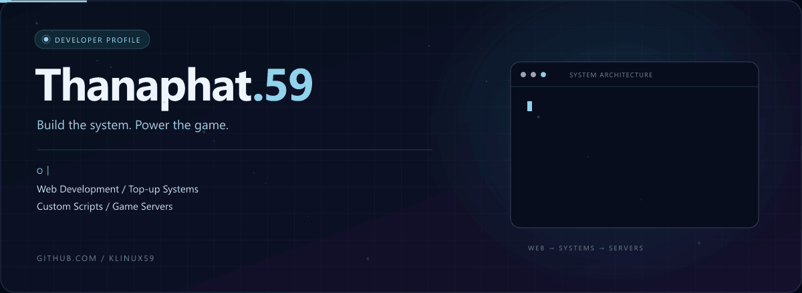
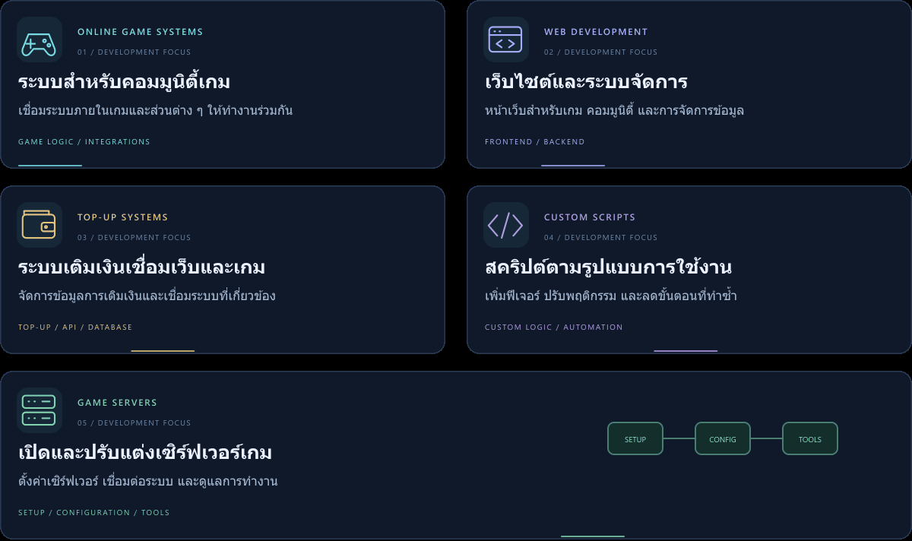
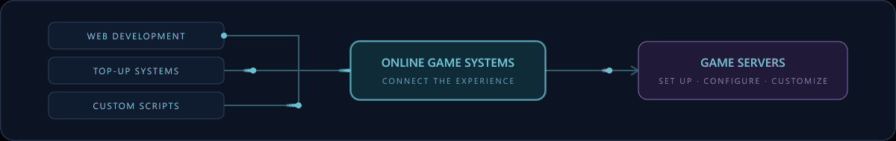
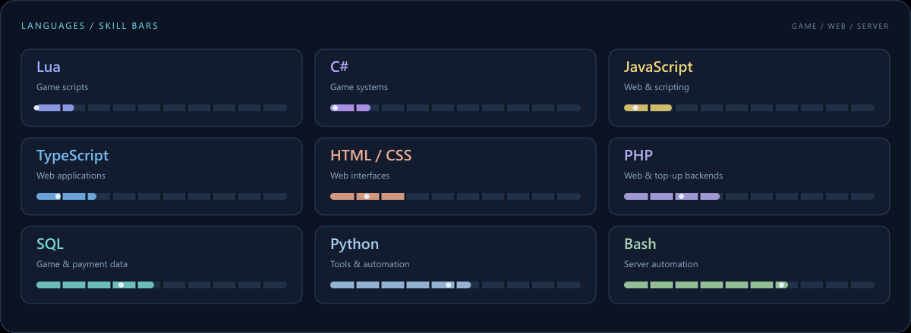
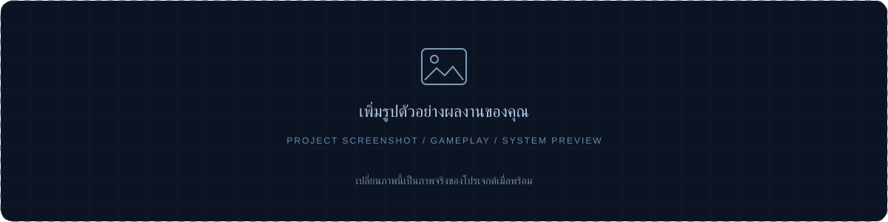
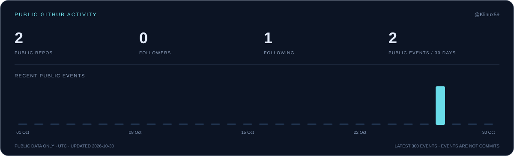
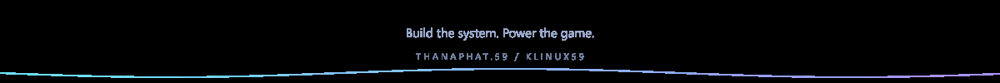

<p align="center">
  
</p>

<p align="center">
  <a href="https://github.com/Klinux59?tab=repositories"></a>
  <a href="https://github.com/Klinux59"></a>
</p>

<h2>01 <sub> / </sub> About me</h2>

สวัสดีครับ ผม **Thanaphat.59** พัฒนาระบบสำหรับเกมออนไลน์ ตั้งแต่เว็บไซต์ ระบบเติมเงิน และสคริปต์ ไปจนถึงการเปิดเซิร์ฟเวอร์เกม โดยให้ความสำคัญกับการเชื่อมระบบต่าง ๆ ให้ทำงานร่วมกัน

**Game systems · Web development · Top-up systems · Custom scripts · Game servers**

```text
thanaphat@59:~$ whoami
  name       Thanaphat.59
  handle     @Klinux59
  focus      Build systems for online gaming communities.
```

<h2>02 <sub> / </sub> What I build</h2>

<p align="center">
  
</p>

<p align="center">
  
</p>

<h2>03 <sub> / </sub> Languages &amp; technology</h2>

ภาษาที่เกี่ยวข้องกับงานเกม เว็บไซต์ ระบบเติมเงิน และการจัดการเซิร์ฟเวอร์

<p align="center">
  
</p>

<h2>04 <sub> / </sub> Projects &amp; things I build</h2>

พื้นที่สำหรับเพิ่มผลงานจริง งานที่กำลังทำ หรือระบบที่เคยพัฒนา เลือกใส่เฉพาะรายการที่พร้อมนำเสนอได้เลย

### 01 / GAME SYSTEMS / CUSTOM SCRIPTS

**ชื่อผลงานเกมหรือสคริปต์** · _รอเพิ่มข้อมูลผลงาน_

<p align="center">
  
</p>

| รายการ | ข้อมูลผลงาน |
| :--- | :--- |
| **ทำอะไร / แก้ปัญหาอะไร** | เพิ่มคำอธิบายสั้น ๆ — เช่น ระบบภายในเกม ฟีเจอร์ หรือสคริปต์ที่พัฒนา |
| **ส่วนที่ผมทำ** | เพิ่มหน้าที่หรือส่วนที่พัฒนาด้วยตัวเอง |
| **ฟีเจอร์เด่น / ผลลัพธ์** | เพิ่มฟีเจอร์หรือผลลัพธ์ที่เกิดขึ้นจริง |
| **ภาษาหรือเครื่องมือที่ใช้** | ใส่เฉพาะภาษาที่ใช้ในโปรเจกต์นี้ |
| **สถานะ** | กำลังพัฒนา / เสร็จแล้ว / เปิดใช้งาน — เลือกตามจริง |
| **ลิงก์ผลงาน / วิดีโอ / ซอร์สโค้ด** | เพิ่มลิงก์ที่ต้องการเปิดเผย |

<!-- รูปผลงาน 01: อัปโหลดรูปไปที่ assets/projects/ แล้วเปลี่ยน src ของภาพด้านบน -->
<!-- เพิ่มลิงก์ด้วยรูปแบบ Markdown: [ดูผลงาน](URL_จริงของคุณ) -->

### 02 / WEB DEVELOPMENT / TOP-UP SYSTEMS

**ชื่อเว็บไซต์หรือระบบเติมเงิน** · _รอเพิ่มข้อมูลผลงาน_

<p align="center">
  
</p>

| รายการ | ข้อมูลผลงาน |
| :--- | :--- |
| **ทำอะไร / แก้ปัญหาอะไร** | เพิ่มคำอธิบายสั้น ๆ — เช่น เว็บไซต์ ระบบสมาชิก หน้าจัดการ หรือระบบเชื่อมต่อการเติมเงิน |
| **ส่วนที่ผมทำ** | เพิ่มหน้าที่หรือส่วนที่พัฒนาด้วยตัวเอง |
| **ฟีเจอร์เด่น / ผลลัพธ์** | เพิ่มฟีเจอร์หรือผลลัพธ์ที่เกิดขึ้นจริง |
| **ภาษาหรือเครื่องมือที่ใช้** | ใส่เฉพาะภาษาที่ใช้ในโปรเจกต์นี้ |
| **สถานะ** | กำลังพัฒนา / เสร็จแล้ว / เปิดใช้งาน — เลือกตามจริง |
| **ลิงก์ผลงาน / วิดีโอ / ซอร์สโค้ด** | เพิ่มลิงก์ที่ต้องการเปิดเผย |

<!-- รูปผลงาน 02: อัปโหลดรูปไปที่ assets/projects/ แล้วเปลี่ยน src ของภาพด้านบน -->
<!-- เพิ่มลิงก์ด้วยรูปแบบ Markdown: [ดูผลงาน](URL_จริงของคุณ) -->

### 03 / GAME SERVERS / TOOLS

**ชื่อเซิร์ฟเวอร์เกมหรือเครื่องมือ** · _รอเพิ่มข้อมูลผลงาน_

<p align="center">
  
</p>

| รายการ | ข้อมูลผลงาน |
| :--- | :--- |
| **ทำอะไร / แก้ปัญหาอะไร** | เพิ่มคำอธิบายสั้น ๆ — เช่น งานตั้งค่าเซิร์ฟเวอร์ เครื่องมือดูแลระบบ หรือระบบอัตโนมัติ |
| **ส่วนที่ผมทำ** | เพิ่มหน้าที่หรือส่วนที่พัฒนาด้วยตัวเอง |
| **ฟีเจอร์เด่น / ผลลัพธ์** | เพิ่มฟีเจอร์หรือผลลัพธ์ที่เกิดขึ้นจริง |
| **ภาษาหรือเครื่องมือที่ใช้** | ใส่เฉพาะภาษาที่ใช้ในโปรเจกต์นี้ |
| **สถานะ** | กำลังพัฒนา / เสร็จแล้ว / เปิดใช้งาน — เลือกตามจริง |
| **ลิงก์ผลงาน / วิดีโอ / ซอร์สโค้ด** | เพิ่มลิงก์ที่ต้องการเปิดเผย |

<!-- รูปผลงาน 03: อัปโหลดรูปไปที่ assets/projects/ แล้วเปลี่ยน src ของภาพด้านบน -->
<!-- เพิ่มลิงก์ด้วยรูปแบบ Markdown: [ดูผลงาน](URL_จริงของคุณ) -->

<h2>05 <sub> / </sub> GitHub activity</h2>

<p align="center">
  <a href="https://github.com/Klinux59?tab=repositories"></a>
</p>

<p align="center">
  <a href="https://github.com/Klinux59?tab=repositories"><b>Explore my public repositories →</b></a>
</p>

<h2>06 <sub> / </sub> Find me</h2>

**GitHub:** [@Klinux59](https://github.com/Klinux59)

<p align="center">
  
</p>

