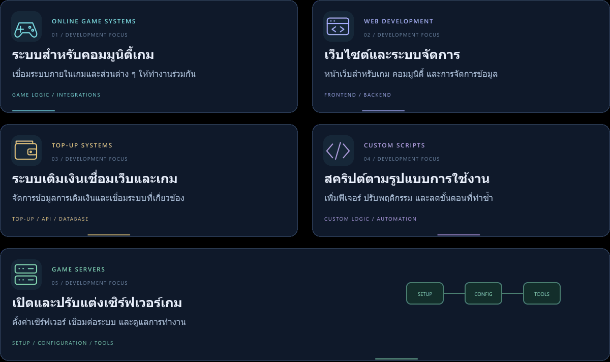
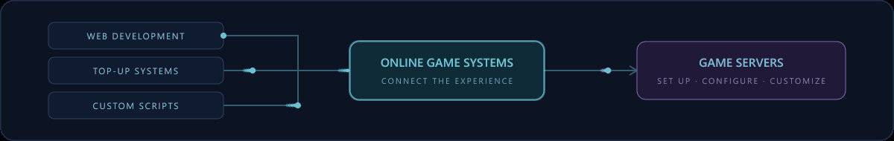
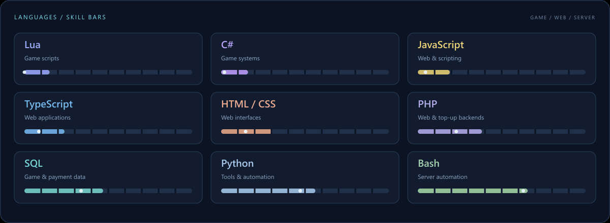
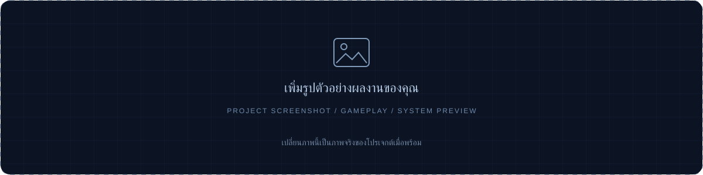
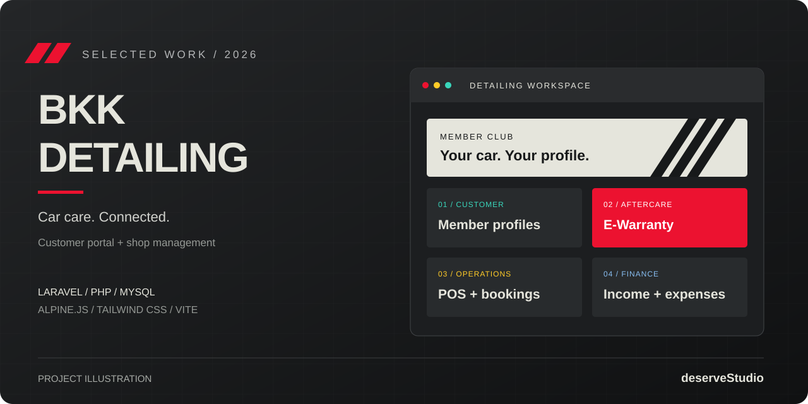
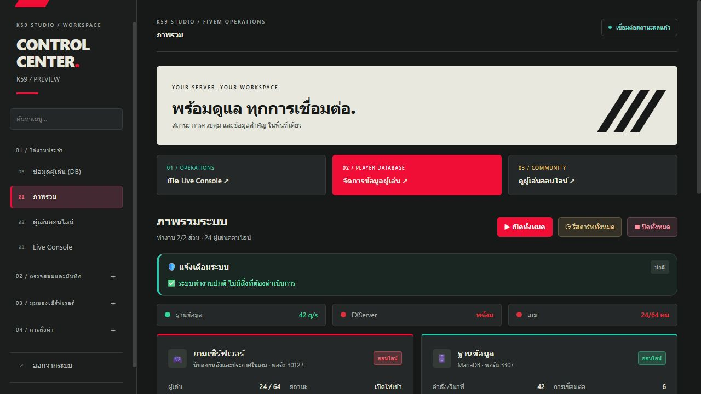
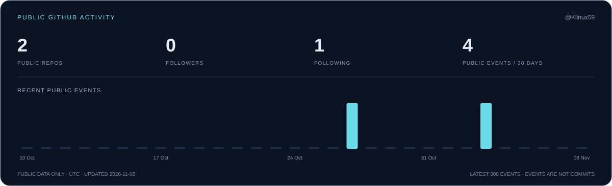

<p align="center">
  
</p>

<p align="center">
  <a href="https://github.com/Klinux59?tab=repositories"></a>
  <a href="https://github.com/Klinux59"></a>
</p>

<h2>01 <sub> / </sub> About me</h2>

**K59 Studio** พัฒนาระบบสำหรับเกมออนไลน์ ตั้งแต่เว็บไซต์ ระบบเติมเงิน และสคริปต์ ไปจนถึงการเปิดเซิร์ฟเวอร์เกม โดยให้ความสำคัญกับการเชื่อมระบบต่าง ๆ ให้ทำงานร่วมกัน

**Game systems · Web development · Top-up systems · Custom scripts · Game servers**

```text
k59studio@workspace:~$ whoami
  name       K59 Studio
  handle     @Klinux59
  focus      Build systems for online gaming communities.
```

<h2>02 <sub> / </sub> What I build</h2>

<p align="center">
  
</p>

<p align="center">
  
</p>

<h2>03 <sub> / </sub> Languages &amp; technology</h2>

ภาษาที่เกี่ยวข้องกับงานเกม เว็บไซต์ ระบบเติมเงิน และการจัดการเซิร์ฟเวอร์

<p align="center">
  
</p>

<h2>04 <sub> / </sub> Projects &amp; things I build</h2>

ผลงานเว็บไซต์และระบบที่พัฒนา รวมถึงพื้นที่สำหรับเพิ่มโปรเจกต์ถัดไป

### 01 / GAME SYSTEMS / CUSTOM SCRIPTS

**ชื่อผลงานเกมหรือสคริปต์** · _รอเพิ่มข้อมูลผลงาน_

<p align="center">
  
</p>

| รายการ | ข้อมูลผลงาน |
| :--- | :--- |
| **ทำอะไร / แก้ปัญหาอะไร** | เพิ่มคำอธิบายสั้น ๆ — เช่น ระบบภายในเกม ฟีเจอร์ หรือสคริปต์ที่พัฒนา |
| **ส่วนที่ผมทำ** | เพิ่มหน้าที่หรือส่วนที่พัฒนาด้วยตัวเอง |
| **ฟีเจอร์เด่น / ผลลัพธ์** | เพิ่มฟีเจอร์หรือผลลัพธ์ที่เกิดขึ้นจริง |
| **ภาษาหรือเครื่องมือที่ใช้** | ใส่เฉพาะภาษาที่ใช้ในโปรเจกต์นี้ |
| **สถานะ** | กำลังพัฒนา / เสร็จแล้ว / เปิดใช้งาน — เลือกตามจริง |
| **ลิงก์ผลงาน / วิดีโอ / ซอร์สโค้ด** | เพิ่มลิงก์ที่ต้องการเปิดเผย |

<!-- รูปผลงาน 01: อัปโหลดรูปไปที่ assets/projects/ แล้วเปลี่ยน src ของภาพด้านบน -->
<!-- เพิ่มลิงก์ด้วยรูปแบบ Markdown: [ดูผลงาน](URL_จริงของคุณ) -->

### 02 / WEB DEVELOPMENT / BKK DETAILING

**BKK Detailing — ระบบจัดการร้านดูแลรถยนต์และสมาชิก**  
พัฒนาและออกแบบโดย **K59 Studio** · อัปเดต **2026**

<p align="center">
  
</p>

ระบบเว็บสำหรับงานหน้าร้านและการดูแลลูกค้าหลังรับบริการ รวมข้อมูลสมาชิก รถ ประวัติบริการ และการรับประกันไว้ในระบบเดียว พร้อมหน้าลูกค้าสำหรับดูข้อมูลของตนเอง

| รายการ | ข้อมูลผลงาน |
| :--- | :--- |
| **ส่วนที่พัฒนา** | ออกแบบ UI และขั้นตอนใช้งาน พัฒนาหน้าลูกค้าและหลังบ้าน เชื่อมการทำงานกับฐานข้อมูล และติดตั้งบนเซิร์ฟเวอร์ |
| **สมาชิกและโปรไฟล์รถ** | สมัครและแก้ไขข้อมูลสมาชิก จัดการรถหลายคัน อัปโหลดรูปโปรไฟล์รถ และดูประวัติบริการ |
| **บริการและการดูแลต่อเนื่อง** | POS จองคิว ใบเสนอราคา แพ็กเกจสมาชิก และ E-Warranty |
| **การเงินและสิทธิ์ผู้ใช้** | บันทึกรายรับรายจ่าย แยกสิทธิ์เจ้าของ พนักงาน และช่าง พร้อมบันทึกกิจกรรม |
| **เทคโนโลยี** | PHP · Laravel 12 · MySQL · Blade · Alpine.js · Tailwind CSS · Vite |
| **เซิร์ฟเวอร์** | Windows Server · XAMPP / Apache · HTTPS |
| **แนวทาง UI** | ดำคาร์บอน ขาวนวล และแดง พร้อมฟอนต์ Kanit รองรับมือถือ |
| **สถานะ** | นำขึ้นเซิร์ฟเวอร์แล้ว อยู่ระหว่างทดสอบและปรับปรุงระบบจริง |
| **เครดิต / ปีอัปเดต** | K59 Studio · 2026 |

**[เปิดเว็บไซต์ BKK Detailing →](https://bkkdetailing.projectfriends.net/customer-login)**

<sub>ภาพด้านบนเป็นภาพประกอบโปรเจกต์ ไม่ใช่ภาพข้อมูลลูกค้าจริง</sub>

### 03 / GAME SERVERS / TOOLS

**FiveM Control Center — ศูนย์ควบคุมเซิร์ฟเวอร์และข้อมูลผู้เล่น**  
พัฒนาและออกแบบโดย **K59 Studio** · อัปเดต **2026**

<p align="center">
  
</p>

เว็บแดชบอร์ดสำหรับดูแลเซิร์ฟเวอร์ FiveM / ESX รวมการควบคุมเกม ฐานข้อมูล ผู้เล่น และบันทึกระบบไว้ในพื้นที่เดียว จัดเมนูตามงานที่ใช้ประจำ พร้อมช่องค้นหาและทางลัดเพื่อลดขั้นตอนการใช้งาน

| รายการ | ข้อมูลผลงาน |
| :--- | :--- |
| **ส่วนที่พัฒนาและปรับปรุง** | ออกแบบ UI และลำดับการใช้งาน จัดหมวดเมนู เชื่อมหน้าควบคุมกับ API เดิม และปรับธีม Player Database ให้สอดคล้องกัน |
| **ควบคุมเซิร์ฟเวอร์** | เปิด ปิด และรีสตาร์ทเกม / FXServer / MariaDB พร้อมการนับถอยหลังและประกาศในเกม |
| **สถานะและประสิทธิภาพ** | แสดงจำนวนผู้เล่น CPU, RAM, เครือข่าย และพื้นที่ดิสก์ พร้อมสถานะการเชื่อมต่อสด |
| **ผู้เล่นและข้อมูล** | รายชื่อผู้เล่นออนไลน์และหน้า Player Database สำหรับดูแลข้อมูลผู้เล่น |
| **ตรวจสอบระบบ** | Live Console, Log Hub, บันทึก Anti-cheat, ประวัติเข้าระบบ และหน้าตรวจความปลอดภัย |
| **การใช้งานที่ชัดเจนขึ้น** | ค้นหาเมนู ทางลัดงานหลัก พับคำสั่งขั้นสูง ยืนยันก่อนปิด / รีสตาร์ท และล็อกปุ่มระหว่างรอคำสั่งเพื่อป้องกันการกดซ้อน |
| **เทคโนโลยี** | Node.js · Express · JavaScript · HTML / CSS · MariaDB / MySQL · Server-Sent Events · Three.js |
| **แนวทาง UI** | ดำคาร์บอน ครีม และแดง แยกสถานะออกจากปุ่มคำสั่ง พร้อมเมนูสำหรับหน้าจอขนาดเล็ก |
| **สถานะ** | อัปเดต UI และติดตั้งในชุดโปรเจกต์แล้ว ตรวจหน้าเว็บด้วยข้อมูลจำลอง ยังไม่ได้ทดสอบคำสั่งควบคุมเซิร์ฟเวอร์จริงหลังอัปเดต |
| **เครดิต / ปีอัปเดต** | K59 Studio · 2026 |

<sub>ภาพด้านบนเป็นหน้าเว็บที่ทดสอบด้วยข้อมูลจำลอง ไม่ใช่ข้อมูลผู้เล่นหรือสถานะเซิร์ฟเวอร์จริง</sub>

<h2>05 <sub> / </sub> GitHub activity</h2>

<p align="center">
  <a href="https://github.com/Klinux59?tab=repositories"></a>
</p>

<p align="center">
  <a href="https://github.com/Klinux59?tab=repositories"><b>Explore my public repositories →</b></a>
</p>

<h2>06 <sub> / </sub> Find me</h2>

**GitHub:** [@Klinux59](https://github.com/Klinux59)

<p align="center">
  
</p>

